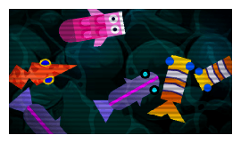

#  CRT effect

Applies a CRT effect, simulating an old cathode-ray tube television. It's useful to give a retro look to a whole scene (apply it to a layer) or to a single screen object like an in-game monitor.

To get the look you want, the main settings to adjust are the **Curvature** (how much the image bulges like a rounded screen), the **Line width** and **Line contrast** (visibility of the scanlines), the **Noise** (static grain), and the **Vignetting** (darkening around the edges).

The effect can also animate on its own: **Interlaced lines speed** controls how fast the scanlines scroll (set it to `0` to keep them still) and **Noise frequency** sets how often the static is refreshed.

## Reference

All effects are listed in [the effects reference page](/gdevelop5/all-features/effects/reference/).
