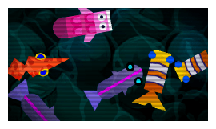

#  CRT effect

Applies a CRT effect, simulating an old cathode-ray tube television.

The look is built from several parts you can mix together:

- **Scanlines**: the **Line width** and **Line contrast** control the thickness and visibility of the horizontal lines. Enable **Show vertical lines** for vertical scanlines instead.
- **Curvature**: bends the image as if displayed on a curved glass tube. Set it to 0 for a flat screen.
- **Noise**: the **Noise** and **Noise size** add animated static over the image.
- **Vignetting**: darkens the corners of the screen (controlled by **Vignetting**, **Vignetting alpha** and **Vignetting blur**).

The static and scanlines can animate over time. **Noise frequency** sets how many times per second the noise refreshes (0 keeps it still), and **Interlaced lines speed** controls how fast the scanlines scroll.

## Reference

All effects are listed in [the effects reference page](/gdevelop5/all-features/effects/reference/).
