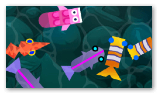

#  Drop shadow effect

Add a drop shadow behind your objects, to give them a sense of depth or make them stand out from the background. It can be added to a single object or to a whole layer.

!!! tip

    When used on an object, a large or far-offset shadow can be cut off at the edges of the object. Increase the **Padding** property to add some extra space around the object so the shadow is fully visible.

## Reference

All effects are listed in [the effects reference page](/gdevelop5/all-features/effects/reference/).
