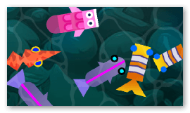

#  Drop shadow effect

Add a drop shadow under your object's visible on the layer.

The position of the shadow is set with the **Distance** (how far the shadow is offset from the object) and the **Rotation** (the direction of the offset, in degrees). **Blur** softens the edges of the shadow and the **Color** and **Alpha** (opacity) let you tint it and make it more or less transparent.

Enabling **Shadow only** hides the object and keeps only its shadow, which is useful to render a separate shadow object you can place and move independently.

!!! note

    If the shadow is cut off at the edges of the object, increase the **Padding** property to enlarge the area in which the effect is allowed to draw.

## Reference

All effects are listed in [the effects reference page](/gdevelop5/all-features/effects/reference/).
