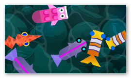

#  Drop shadow effect

Add a drop shadow around your object, visible on the layer. It's commonly used to make objects, cards or UI panels appear to float above the background.

The **distance** and **rotation** parameters control how far the shadow is cast and in which direction, while **blur** softens its edges and **color** tints it. Enable **Shadow only** to render just the shadow without the original image — useful to display a separate ground shadow behind a character.

## Reference

All effects are listed in [the effects reference page](/gdevelop5/all-features/effects/reference/).
