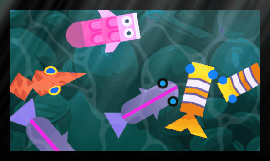

#  God rays effect

Cast rays of light from the top of the screen. **This won't work well if shown on top of the background color of the scene**. Be sure to use an object acting as a background or a floor.

The **Angle** tilts the rays and the **Center X**/**Center Y** move the point the light seems to come from (useful to make the rays originate from a window or the sun). **Light** controls how far the rays reach and **Gain** how bright they are. The rays are animated over time: set the **Animation speed** to 0 to keep them perfectly still.

Enabling **Parallel** makes all rays point in the same direction (like distant sunlight); disabling it makes them spread out from the center point (like a nearby light source).

## Reference

All effects are listed in [the effects reference page](/gdevelop5/all-features/effects/reference/).