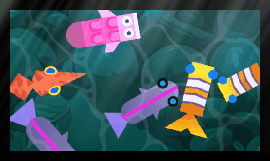

#  God rays effect

Cast and animate atmospheric rays of light. **This won't work well if shown on top of the background color of the scene**. Be sure to use an object acting as a background or a floor.

The **angle** parameter controls the direction the rays point, and the **Center X**/**Center Y** parameters set the point the light appears to come from. Enable **Parallel** for straight, parallel sunbeams, or disable it to make the rays spread out from the center point (like a lamp or a sun close to the scene). The effect animates on its own: the **Animation speed** parameter sets how fast the rays shimmer.

## Reference

All effects are listed in [the effects reference page](/gdevelop5/all-features/effects/reference/).