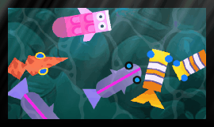

#  God rays effect

Cast animated rays of light to create an atmospheric, sunlight-through-clouds look. **This won't work well if shown on top of the background color of the scene**. Be sure to use an object acting as a background or a floor.

Use the **Angle** and **Center X**/**Center Y** properties to point the rays towards the light source in your scene. Enable **Parallel** for evenly spaced rays (like distant sunlight), or disable it to make the rays spread out from the center point (like a nearby lamp). The **Animation Speed** controls how fast the rays shimmer — set it to `0` to keep them static.

## Reference

All effects are listed in [the effects reference page](/gdevelop5/all-features/effects/reference/).