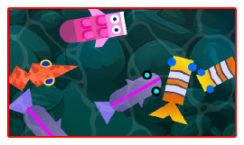

#  Outline

Add an outline on all objects of the layer having the effect.  **This won't work well if shown on top of the background color of the scene**. Be sure to use an object acting as a background or a floor.

Use **Thickness** to set how wide the outline is and **Color** to set its color. Applied to a single object (rather than a layer), this is a handy way to highlight it — for example to show the currently selected unit or an interactable item.

!!! note

    This effect only works on 2D objects and layers.

## Reference

All effects are listed in [the effects reference page](/gdevelop5/all-features/effects/reference/).