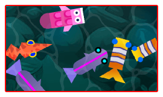

#  Outline

Draw an outline around an object (or all objects of a layer having the effect).  **This won't work well if shown on top of the background color of the scene**. Be sure to use an object acting as a background or a floor.

The **thickness** and **color** parameters set the width and tint of the outline. This is handy to highlight an interactive object (an item to pick up, a selected unit) or to give a whole scene a cartoon look. You can animate the thickness or color [through events](/gdevelop5/objects/effects) to make an object pulse when it becomes selectable.

## Reference

All effects are listed in [the effects reference page](/gdevelop5/all-features/effects/reference/).