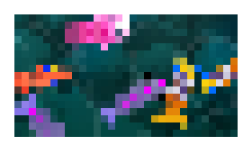

#  Pixelate effect

Applies a pixelated effect, making display objects appear 'blocky'.

The **Size** parameter sets how large the pixel blocks are: the higher the value, the blockier the result. Gradually changing this value during the game (with the "Effect Parameter" action) is a quick way to make a scene or object pixelate in and out, for a retro transition or a teleport effect.

!!! note

    For pixel-perfect or 8-bitgames, you can change the **Scale mode** options in your [game properties](/gdevelop5/interface/project-manager/properties) instead of using this effect.

## Reference

All effects are listed in [the effects reference page](/gdevelop5/all-features/effects/reference/).