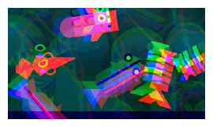

#  RGB split effect

Separate each component's RGB(red, green, blue) colors and display them on the screen with an offset:

Each of the red, green and blue channels has its own X and Y offset, so you can push the colors apart in any direction. Animating these offsets [through events](/gdevelop5/objects/effects) — for example jittering them for a few frames — is a quick way to create glitch, damage, teleport or retro-screen effects.

## Reference

All effects are listed in [the effects reference page](/gdevelop5/all-features/effects/reference/).
