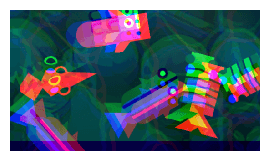

#  RGB split effect

Separate each component's RGB(red, green, blue) colors and display them on the screen with an offset:

Each color channel has its own X and Y offset, so you can control how far apart the red, green and blue copies are pulled. A small offset gives a subtle chromatic aberration, while a large one creates a glitchy, distorted look. Animating the offsets with events (for example, increasing them briefly when the player takes damage) is an easy way to add a screen-shake-like impact effect.

## Reference

All effects are listed in [the effects reference page](/gdevelop5/all-features/effects/reference/).
