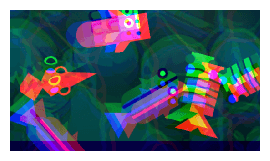

#  RGB split effect

Separate each component's RGB(red, green, blue) colors and display them on the screen with an offset:

Each color channel has its own **X offset** and **Y offset** (in pixels), so you can move the red, green and blue channels independently. This produces a *chromatic aberration* look, often used for glitch effects, damage feedback or an old-screen aesthetic. Animating the offsets with events makes the separation pulse or flicker.

## Reference

All effects are listed in [the effects reference page](/gdevelop5/all-features/effects/reference/).
