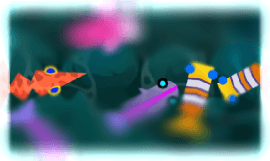

#  Tilt shift effect

Add blur to the top and bottom of the entire layer or object. Perfect to simulate a tiny world or a camera focus effect.

The **Blur** property sets how strong the blur is at the top and bottom, while the **Gradient blur** controls how gradually it fades toward the sharp band in the middle: a small value gives an abrupt transition, a large one a smooth fade.

## Reference

All effects are listed in [the effects reference page](/gdevelop5/all-features/effects/reference/).
