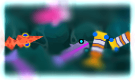

#  Tilt shift effect

Add blur to the top and bottom of the entire layer or object. Perfect to simulate a tiny world or a camera focus effect.

## Properties

- **Blur** sets how strong the blur is at the top and bottom of the image.
- **Gradient blur** controls how quickly the image transitions from sharp (in the middle) to blurred (at the edges). A larger value makes the sharp band wider and the transition more gradual.

## Reference

All effects are listed in [the effects reference page](/gdevelop5/all-features/effects/reference/).
