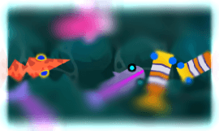

#  Tilt shift effect

Add blur to the top and bottom of the entire layer or object, keeping a sharp band across the middle. Perfect to simulate a tiny world or a camera focus effect.

The **blur** parameter sets how strong the blur is at the edges, while **Gradient blur** controls how gradually it fades from the sharp central band to the blurred areas (a larger value makes the transition softer and the sharp band narrower).

## Reference

All effects are listed in [the effects reference page](/gdevelop5/all-features/effects/reference/).
