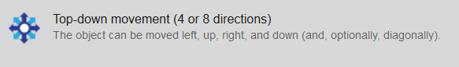
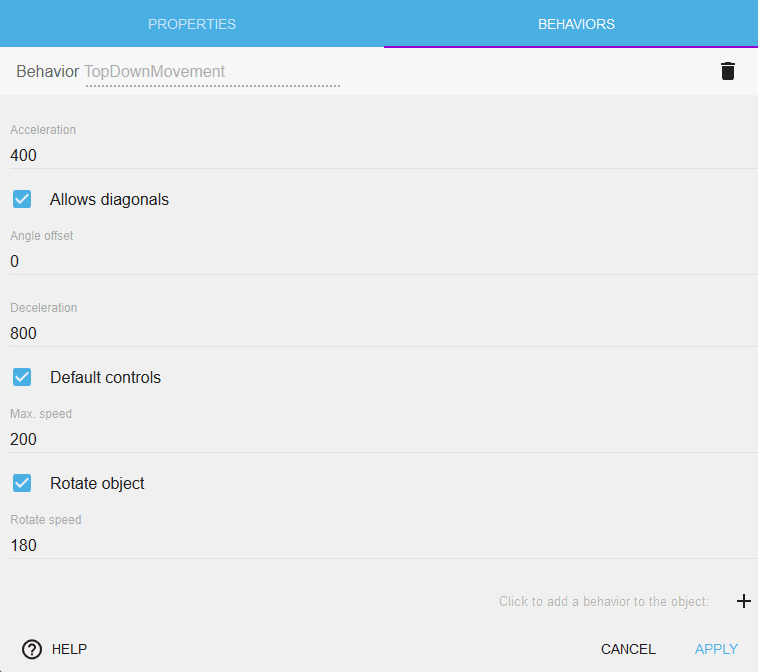
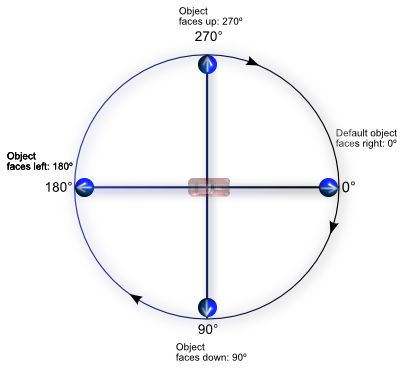
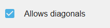
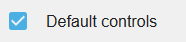
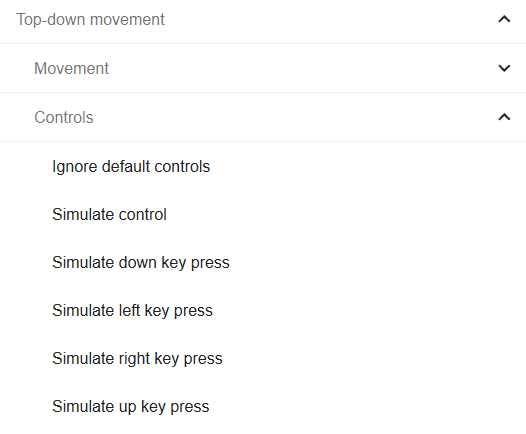
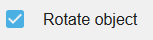
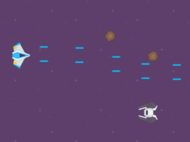
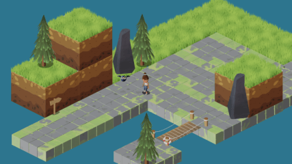

# Top-Down Movement behavior

The top-down movement behavior moves an object in 4 or 8 directions, like the characters of RPGs, top-down shooters, racing games seen from above or isometric games.

!!! tip

    **See it in action!** 🎮 Jump to [the examples](#examples) to try it in your browser.

  <iframe src="https://www.youtube.com/embed/zUV-lUtXpO4" frameborder="0" allowfullscreen></iframe>

## Add the behavior

Add the "Top-Down Movement" [behavior](/gdevelop5/behaviors) to an [object](/gdevelop5/objects) to move it in either 4 or 8 directions.

After adding the behavior, its properties are shown:

## Speed of movement and rotation

**Acceleration**, **Deceleration** and **Max speed** set how fast the object moves, and how quickly it starts and stops: a high acceleration and deceleration feel responsive, low values feel like sliding on ice.

**Rotation speed** sets how fast the object turns toward the direction of its movement (see [Rotate the object](#rotate-the-object) below).

## Angle offset

By default, an object with an angle of 0 faces the right of the screen. If the image of your object faces another direction (for example, up), change the **Angle offset** so that it faces the direction of its movement. Here is an image to help you understand the angles in GDevelop:

!!! note

    Note that some expressions like `AngleBetweenPositions` can give you a result between -180 and 180. This is equivalent to this schema. An angle of -45 degrees is equivalent to an angle of 270 degrees.

## Viewpoint (for isometric games)

The **Viewpoint** property controls how movement directions are projected onto the screen. This is essential for isometric games where the visual perspective differs from the movement plane.

* **Top-Down** (default): Movement directions map directly to screen axes. Moving right moves the object right on screen.
* **Isometry 2:1**: Uses a classic pixel isometry projection (approximately 26.6°), the style common in many retro strategy games. The movement directions are transformed so that "forward" on screen matches the isometric visual perspective.
* **True Isometry (30°)**: Uses a mathematically perfect 30-degree isometric projection.
* **Custom Isometry**: Allows specifying any isometry angle, useful for non-standard perspectives.

When using an isometric viewpoint, it is also recommended to set the **Movement angle offset** to **-45 degrees**. This rotates the input directions so that pressing "up" moves the character toward the top of the isometric view rather than straight up on screen.

!!! tip

    See the **Isometric Game** example below for a working demonstration of how to combine the Isometry viewpoint with the movement angle offset.

## Diagonals

With **Allows diagonals**, the object moves in 8 directions. Disable it to move only in 4 directions (left, right, up and down), like in many classic RPGs and puzzle games.

## Controls

### Move characters with keyboards

The behavior moves the character with the arrow keys of the keyboard. To use other keys (like WASD), or to move characters controlled by the computer, disable **Default controls** and use the actions of the behavior to simulate key presses, for example with [keyboard conditions](/gdevelop5/all-features/keyboard):

### Move characters with gamepads

The "top-down gamepad mapper" behavior from the [gamepad extension](/gdevelop5/all-features/gamepad) can be added to characters to make them move according to the inputs of players automatically.

### Move characters with multi-touch controls

The "top-down multitouch controller mapper" behavior from the [multi-touch joystick extension](/gdevelop5/objects/multitouch-joystick) can be added to characters to make them move according to players touches automatically.

## Rotate the object

With **Rotate object**, the object turns toward the direction of its movement, at the **Rotation speed**. Disable it for objects that must not rotate.

For characters that face different directions using separate animations rather than rotation (for example, a top-down RPG character with separate walk-left and walk-right animations), disable rotation and use the movement angle expression to determine which animation to play with events.

All these values can also be changed at any time during the game using [events](/gdevelop5/events).

## Examples

Open these examples in GDevelop to see the behavior in action.

**Space Shooter**

[Open example in GDevelop](https://editor.gdevelop.io/?create-from-example=space-shooter){ .md-button .md-button--primary }

[{ width="320" }](https://editor.gdevelop.io/?create-from-example=space-shooter)

**Isometric Game** (creates an illusion of 3D graphics within a 2D graphics game)

[Open example in GDevelop](https://editor.gdevelop.io/?create-from-example=isometric-game){ .md-button .md-button--primary }

[{ width="320" }](https://editor.gdevelop.io/?create-from-example=isometric-game)

## Reference

All actions, conditions and expressions are listed in [the top-down movement reference page](/gdevelop5/all-features/top-down-movement-behavior/reference/).