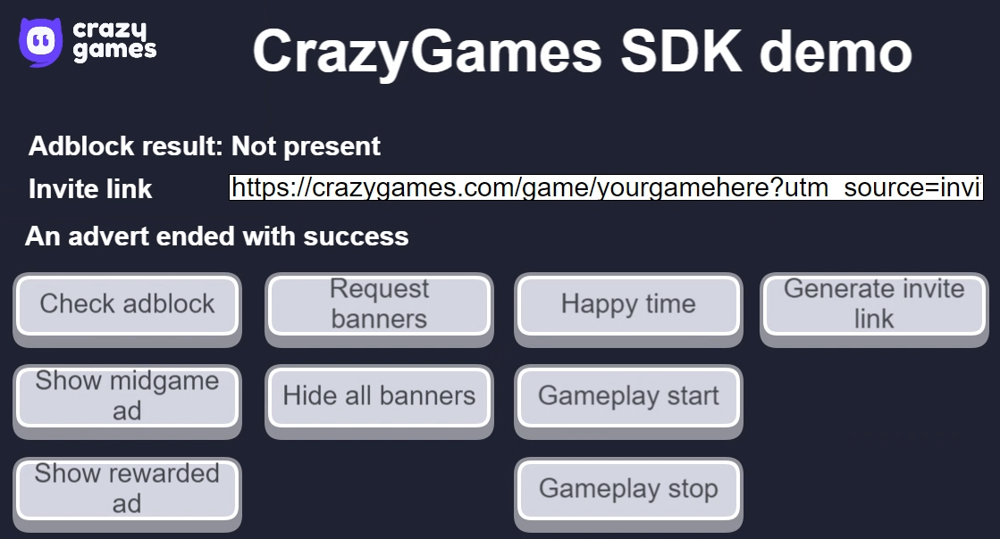
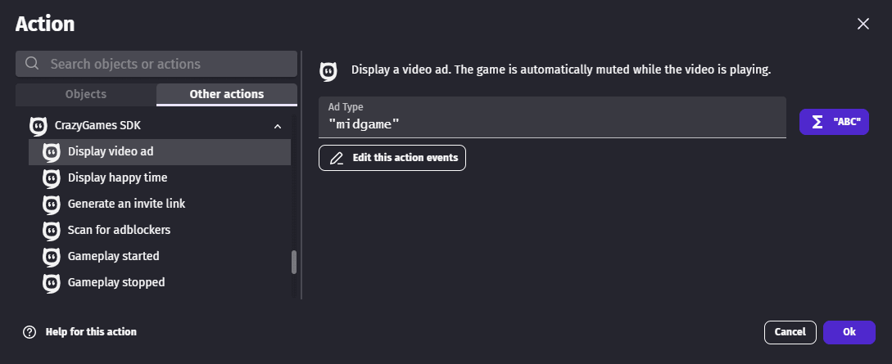
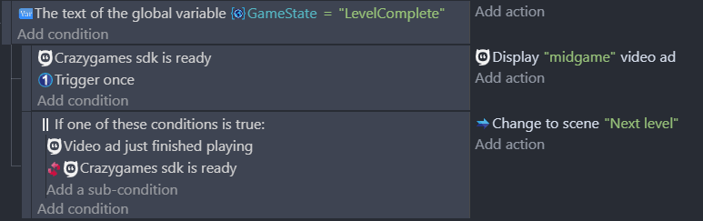
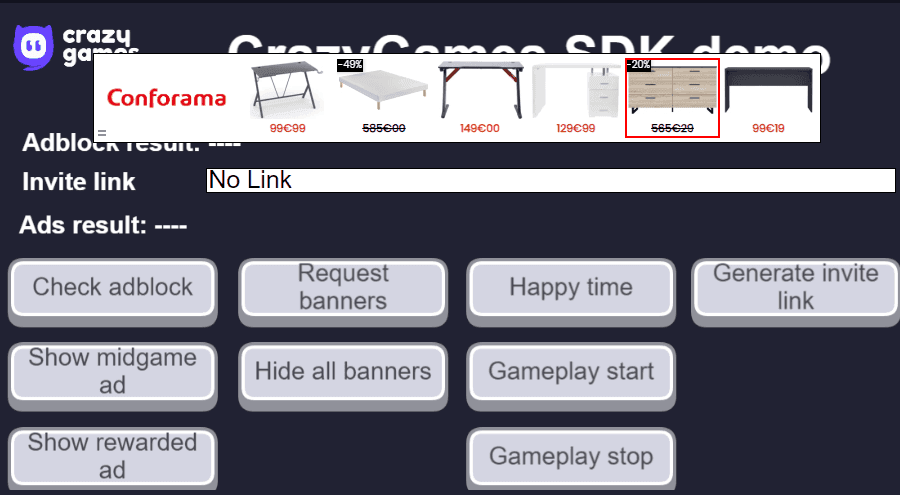
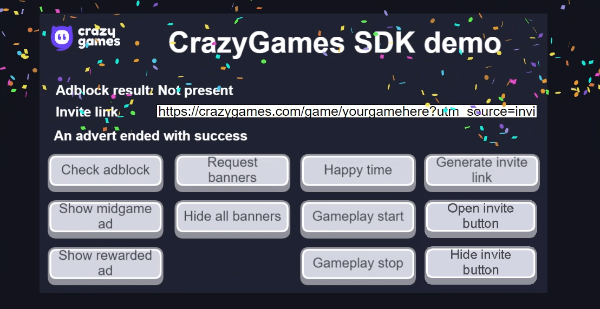
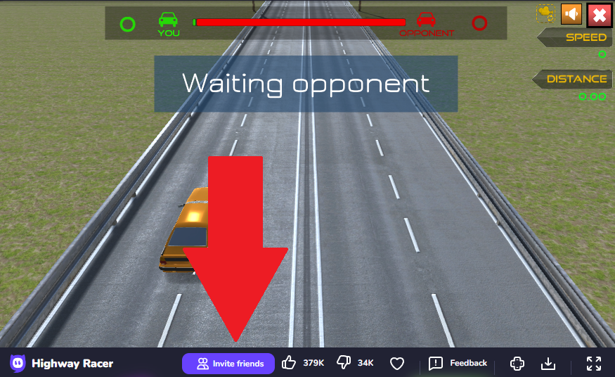
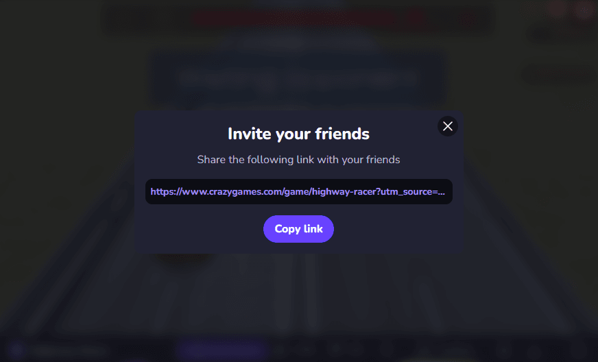

# CrazyGames SDK Extension

This extension allows games to be hosted on the CrazyGames website and display modules in games such as ads, banners, and various functionalities offered by CrazyGames.

!!! note

    Please refer to the [CrazyGames SDK documentation](https://docs.crazygames.com/sdk/intro/) to learn how to set up compatible environments for games and to get tips about development and testing with their *QA Tool*.

## Try the CrazyGames SDK demo

A **demo project** highlights how to use the CrazyGames SDK in GDevelop.
It can be exported as an HTML5 game and uploaded as a new submission for QA on the [CrazyGames Developer Portal](https://developer.crazygames.com/games).

[Open the demo](https://gdevelop.io/game-example/free/crazygames-sdk-demo){ .md-button .md-button--primary }

## Display Video Ads

A video ad filling the entire game screen can be displayed using the **Display video ad** action. An ad can either be `"midgame"` or `"rewarded"`.

- **Midgame**: Show an advertisement when a user dies, a level has been completed, etc.

- **Rewarded**: An advertisement that can be requested by the user in exchange for a reward (an additional life, a retry when the user dies, a bonus starting item, extra starting health, etc.). Rewarded ads should be shown when users explicitly consent to watch an advertisement.

You can use the **Video ad just finished playing** condition to resume the game after the end of the ad.

### Adblock detection

CrazyGames games must be playable even if an ad blocker exists. To avoid blocking in your game, you can use the **Ad blocker is detected** condition, or use it to restrict certain parts of your game while warning your players that by deactivating their blocker they will be able to access the rest of the content.

## Banners
### Request a Banner

An ad banner can be placed with X and Y position and use a part of the game screen. CrazyGames serves banners in these sizes: `728x90`, `300x250`, `320x50` and `468x60`. The other sizes offered by the action are not served by CrazyGames.

!!! warning

    The same banner can be displayed again only 20 seconds after its last display. If it is requested before that, an error is returned in the debugger and is also readable with the **Get last error** expression, which returns a string.

    The banner must also be fully inside the game window, otherwise it won't be displayed.

Banners are not available in every session: CrazyGames doesn't show them during Basic Launch, in Kids mode or when the game runs in the CrazyGames mobile app. Your game must work without them, and the **Get last error** expression explains why a banner wasn't shown.

### Clearing the Banners

There are two possible actions for clearing banners:

- Delete all the banners in game.
- Delete a banner by its name.

## Game

### Game Settings

The game can have setting(s) for:

| Setting | Expression |  |
|-----|-----|-----|
| Is the chat disabled | See the expression in [the references](/gdevelop5/extensions/crazy-games-ad-api/#expressions). ||

### Gameplay start/stop

Some actions or events are triggered automatically and can be used to track when and how users are playing your games. You can get the stats directly on the CrazyGames game dashboard.

- The **Gameplay Start** action has to be called whenever the player starts playing or resumes playing after a break (menu/loading/achievement screen, game paused, etc.).

- The **Gameplay Stop** action has to be called on every game break (entering a menu, switching levels, pausing the game, etc.). Don't forget to call the Gameplay Start when the gameplay resumes.

### Happy Time

Celebrate special moments in the game with sparkling confetti. Celebrate the defeat of a boss, reaching a new high score, or something big.

### Multiplayer Features

Games can be joined directly in multiplayer mode.

Use the expression **Is instantly joining a lobby** to determine if the player should be forwarded directly to a game lobby or multiplayer mode.

If the expression returns true, your game should immediately switch to multiplayer mode.

### Invite Link

Returns a URL to invite friends to join your game session. This URL can be added to the clipboard or displayed in the game to let the user select it.

### Invite Button

Display on CrazyGames website a popup containing the invite link with a copy button. This is very useful in a multiplayer game to give a friend the possibility to join a session quickly. 

!!! warning

    CrazyGames is deprecating the invite button in favour of [room data](https://docs.crazygames.com/sdk/game/#room-data), which this extension doesn't support yet.

## User
The user conditions and actions are only usable on CrazyGames' website. Be sure to check the availability of their information once the user is logged.

### Auth prompt

Use the action **Show CrazyGames login window** to ask the player to log in to the game before getting their information for the multiplayer.

### Check availability

The **Is user account available** is an expression that returns True when the player is playing on CrazyGames. It returns False on other websites that embed your CrazyGames game.

###  Retrieve user data

Use this action to fetch the user information/data from CrazyGames gaming platform.

!!! note

        When the SDK is loaded an automatic silent authentification is called, and when the action **Retrieve user data** is triggered there is also an automatic check for the authentification to ensure the player is logged, if not logged The Auth Prompt is called.

Once availability is confirmed and the user is logged in, the game can access the player's information:

- The Username
- The URL of the profile picture
- The system information (Country code, OS, browser, device)
- The user token (An encoded string of the user information, [read more](https://docs.crazygames.com/sdk/user/#get-user-token))

 See [the references](/gdevelop5/extensions/crazy-games-ad-api/#expressions) to see how to use the expressions to get these informations.

!!! note

    The user token returned by this extension is signed with CrazyGames' legacy key. If your server verifies the token, use the legacy public key at [https://sdk.crazygames.com/publicKey.json](https://sdk.crazygames.com/publicKey.json), as explained in [Verify the token](https://docs.crazygames.com/sdk/user/#verify-the-token).

### Account link prompt

**Show account link prompt** action is made for supporting advanced account use cases, you'll need to handle account linking between the CrazyGames account and the other providers. Check [User linking page](https://docs.crazygames.com/sdk/user-linking/user-linking-html5-v3/) to find out more about user account linking.

## Data

The data allows saving and retrieving user progress. For players logged in to CrazyGames, the data is synced on all the devices where they play the game.

For guest players, the data is stored in the browser. When a guest logs in, CrazyGames automatically transfers their guest progress to their account if they haven't played the game with that account before.

To save data, use the **Save session data** action.
A parameter name will be requested to store your data and retrieve it via the **Get user session data** expression.

!!! warning

    Select the **Progress Save** option when you submit your game on the CrazyGames Developer Portal, otherwise the data won't be saved. Rely only on these actions to save progress, for both guests and logged-in players, rather than on other storage such as the Storage actions.

!!! warning

    There is a 1MB data limit: data above it isn't backed up anymore. The save is made 1 second after the action is called, and can sometimes be delayed by up to 30 seconds. Be careful not to perform this action on all frames.

## In-game Purchase

CrazyGames has partnered with [Xsolla](https://xsolla.com/) to offer you the possibility to integrate in-game purchases. Purchases are only available to players signed in to CrazyGames: guest players must not be able to buy items. In-game purchases are invite-only, so you must [get in touch with CrazyGames](mailto:developer-relations@crazygames.com) first.

Once you are invited, you can then get access to the Xsolla project dashboard and get a token from Xsolla to manage transactions in your game thanks to the **Generate Xsolla token** action, which gets a fresh authentication token that is valid for 1 hour. We recommend that you retrieve the token each time before using it for a transaction.

To perform transactions you must [use the Xsolla SDK as explained here](https://docs.crazygames.com/sdk/in-game-purchases/#registering-orders).

## Debug and Testing

### Ad error

To check if an ad has encountered an error, you can directly use the condition **Video ad had an error** to bypass a moment in your game.

### Catch any errors

To help debug your game and view errors or other responses from the SDK, you can use the expression **Get last error** which returns a String.

If you want to check for a specific error, the condition with the same name can be used to filter parts of your events.

!!! tip
    
        Use this expression alongside the console log action to capture errors in the debugger or display them in a text object.

### Testing in the QA tool

To test ads and banners, your game needs to be uploaded to the QA Tool from the [CrazyGames Developer Portal](https://developer.crazygames.com/games). Doing so will help you verify each action and expression to ensure your game functions correctly and meets the validation requirements for their gaming platform.

# References
!!! tip

    Learn more about all the events from the extension on the [reference page](/gdevelop5/extensions/crazy-games-ad-api/).
