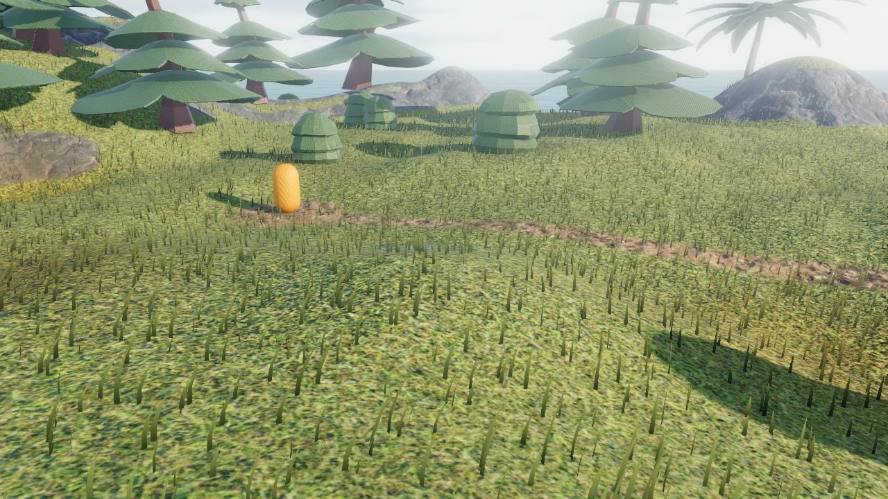

# Terrain grass

The **terrain grass** object covers the ground with thousands of blades of grass, swaying in the wind and pushed aside by the characters walking through them. It brings life to meadows, gardens or the sides of a road at a low cost.

## Add grass

Add a **Terrain grass** object (in the "New object from scratch" tab of the new object dialog) and put an instance over the [3D terrain](index.md). The width and height of the instance are the area where grass grows. Grass grows on the highest terrain at each point of the area (so one field of grass can cover several terrains side by side), or at the Z position of the instance where there is no terrain.

The grass follows the ground: sculpt or paint the terrain, and the grass moves, appears or disappears with it.

## Choose where grass grows

- **Grows on terrain layer**: blades only grow where this layer is painted on the terrain (usually layer 1, the grass layer). Paint a path, a road or a beach with another layer, and no grass grows there.
- **Maximum slope**: no grass grows on steeper ground, like cliffs.
- There is no grass in the [holes](holes-and-tunnels.md) of the terrain.

The blades take the [tint](sculpting-and-painting.md#tinting-the-ground) of the ground under them: tint a patch of the meadow in yellow and the grass is dry there too.

## Make it look the way you want

- **Density**, **Blade height** and **Blade width**: a dense lawn, a sparse steppe, or tall grass up to the knees.
- **Base color** and **Tip color**: blades go from the base color at the ground to the tip color at their top. Use darker and more saturated colors at the base to give depth to the grass.
- **Wind strength** and **Wind speed**: from a light breeze to a storm. Set the strength to 0 for grass that doesn't move.
- **Object bending the grass**: the name of an object (usually the player) pushing the blades aside as it walks through them.

## Performance

Grass is drawn efficiently, but thousands of blades still have a cost, especially on phones:

- Only put grass where the player can see it closely. Instead of a single grass object covering a whole world, use several instances on the meadows, gardens and roadsides where the player goes (the 3D GTA with a map example uses three).
- **Fade distance**: blades become less dense with the distance to the camera, and are hidden after this distance. A lower fade distance is faster. Far away, the color of the grass layer of the terrain is enough to show grass.
- Lower the **density** on mobile games, and compensate with taller or wider blades.

See also [Tips and best practices](tips.md).
