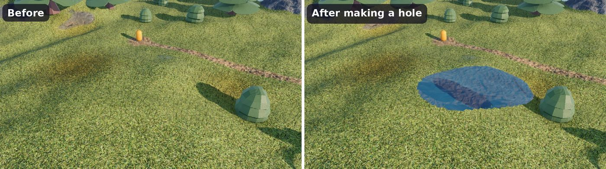
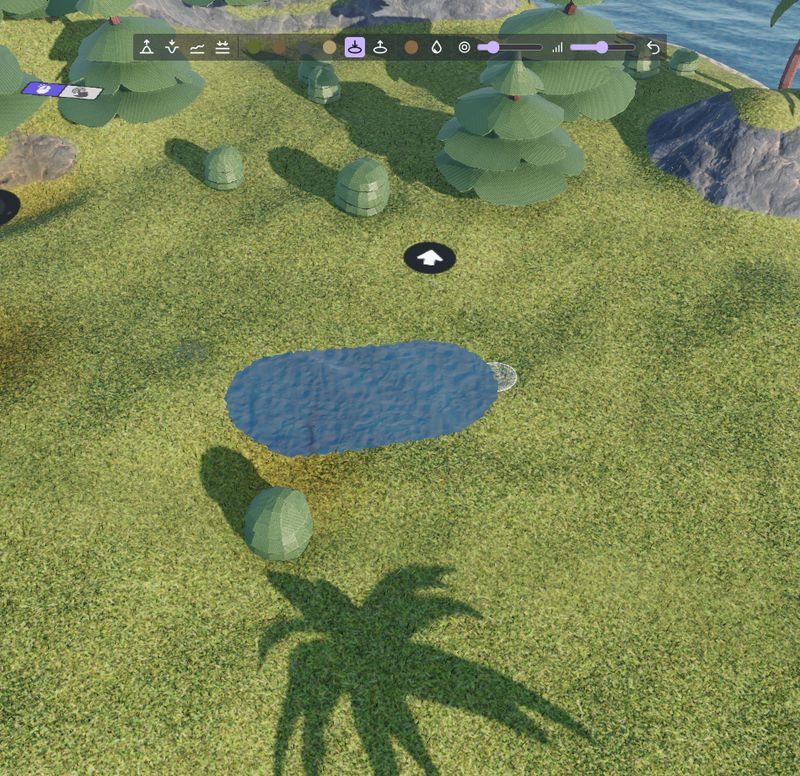
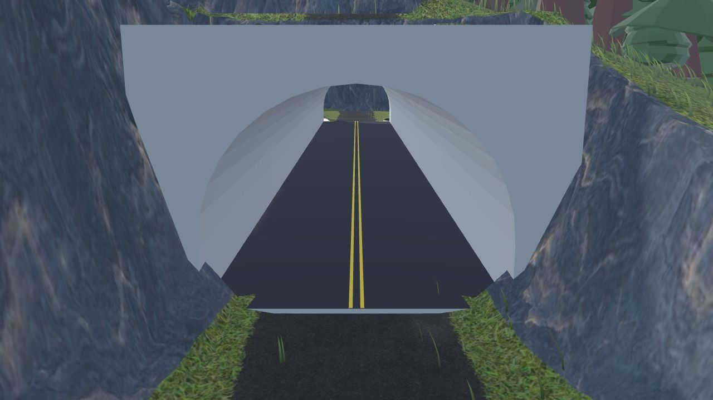
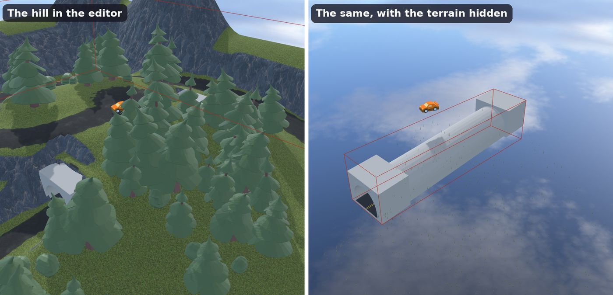
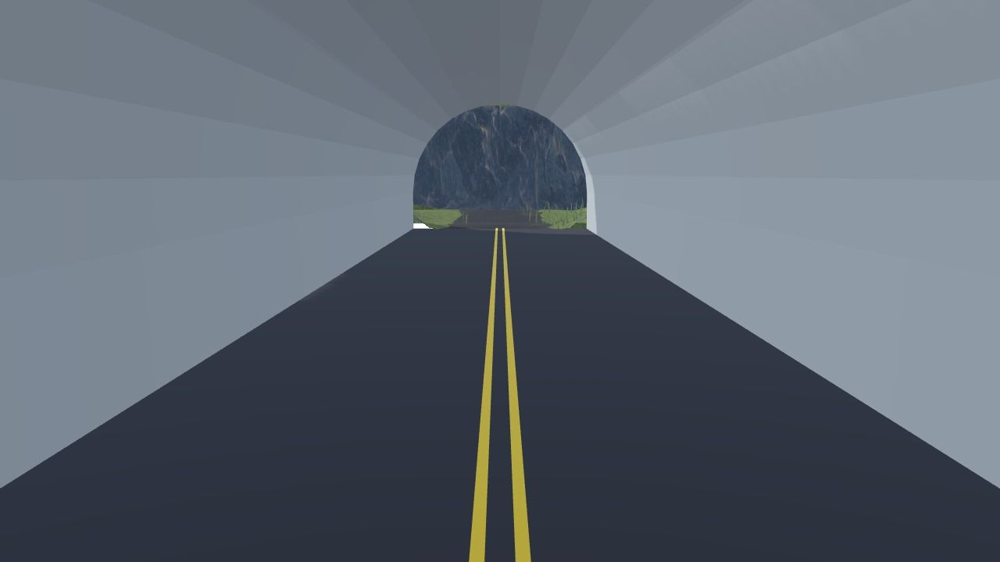

# Holes, tunnels and caves

A [3D terrain](index.md) can have **holes**: there is no ground there, nothing is drawn, characters and objects fall through them, and the [grass](grass.md) and [scattered models](scattered-models.md) don't grow there. Holes are the entrances of tunnels, caves, wells or mines, and can also be dug during the game.

## Make and fill holes in the scene editor

Select the terrain, then:

- **Make a hole** removes the ground in the brush circle.
- **Fill holes** brings back the ground in the brush circle. Holes are filled with the layers of the ground around them, so a hole in grass is filled with grass.

Like the other brushes, use **Undo** to remove the last strokes. Holes can also be written in the **Edits** property of the terrain (the `hole` and `fill` tools), see [The "Edits" property](sculpting-and-painting.md#the-edits-property-a-terrain-described-in-text).

!!! note

    A height field can't go under itself: a hole is only an opening in the ground. What's under the ground (the tunnel, the cave, the bottom of the well) is made with 3D models, as explained below.

## Make a tunnel

A tunnel through a hill is made of a few parts:

1. **A 3D model of the tunnel**: a tube with a road inside, made in a 3D modeling software (like Blender) or found in an asset pack, and added as a [3D model object](/gdevelop5/objects/3d-model). Place it under the hill, with its ends at the faces of the hill.
1. **Collisions inside the tunnel**: add the [3D physics behavior](/gdevelop5/behaviors/physics3d) to the tunnel, with the "Static" type and the "Mesh" shape: characters and cars drive on its road and are stopped by its walls.
1. **Roads to the entrances**: flatten the ground in front of each entrance down to the floor of the tunnel, and paint the road.
1. **Holes at the entrances**: make holes where the ground would be inside the tunnel, near its ends. Keep the ground above the rest of the tunnel: the player never sees the outside of the tube.

Here is what's hidden under the hill of the "3D GTA with a map" example. The tunnel is a 3D model, with big concrete blocks around each entrance (the portals). They fill the space between the tube and the ground, so that only the tunnel is seen through the holes, whatever the angle of the camera:

!!! tip

    Make the ends of your tunnel model a bit larger than the holes, and make the holes a bit smaller than the inside of the tunnel. The edge of a hole always looks smooth, but collisions are removed for whole cells of the terrain, so the hole in the collisions can be up to one cell larger than the hole drawn. A tunnel model going a bit further than the hole covers the difference. Rocks or bushes around an entrance are another good way to hide the edges.

Inside the tunnel, a camera following the player from far away could end up in the hill. Bring it closer while the player is under the ground: the "3D GTA with a map" example does it by comparing the Z position of the car with the **ground Z position** of the terrain above it, and changing the distance of its [third person camera](/gdevelop5/extensions/third-person-camera).

## Caves, wells and mines

The same recipe works for other places under the ground:

- **A cave**: a hole in the side of a mountain, in front of a 3D model of the cave, with a mesh collision shape.
- **A well or a pit**: a hole in flat ground, above a 3D model of the shaft (a cylinder open at the top).
- **A mine with several entrances**: one model for the galleries, and a hole at each entrance.

The **Carve an entrance** action makes the entrance of a tunnel or a cave on a slope, in one step: it flattens the ground in front of the entrance to the floor of the tunnel, and makes the hole.

## Holes during the game

Holes can be made and filled with actions during the game: dig into the ground, open a trap door in the floor, collapse the ground under a heavy object, or reveal the entrance of a secret cave when the player finds a key. Collisions are updated: objects above a new hole fall in it.

To know if there is a hole at a position, use the **Hole** condition. The **Ground Z position, with holes** expression gives the height of the ground, or a value of your choice where there is a hole (for example a value far under the ground), to place objects only where there is ground. All the actions, conditions and expressions are listed in the [reference of the 3D terrain extension](/gdevelop5/extensions/terrain3d).
