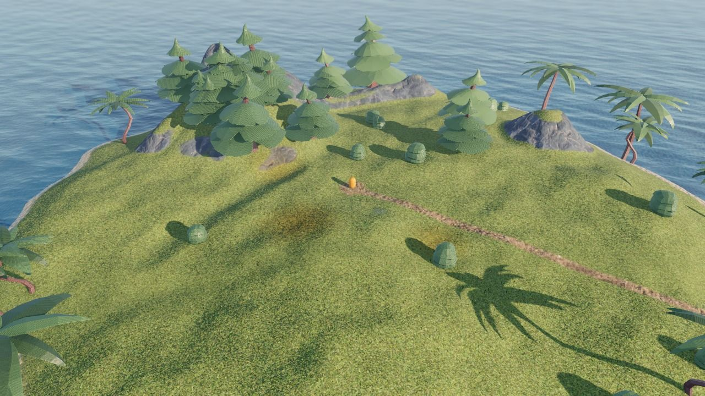
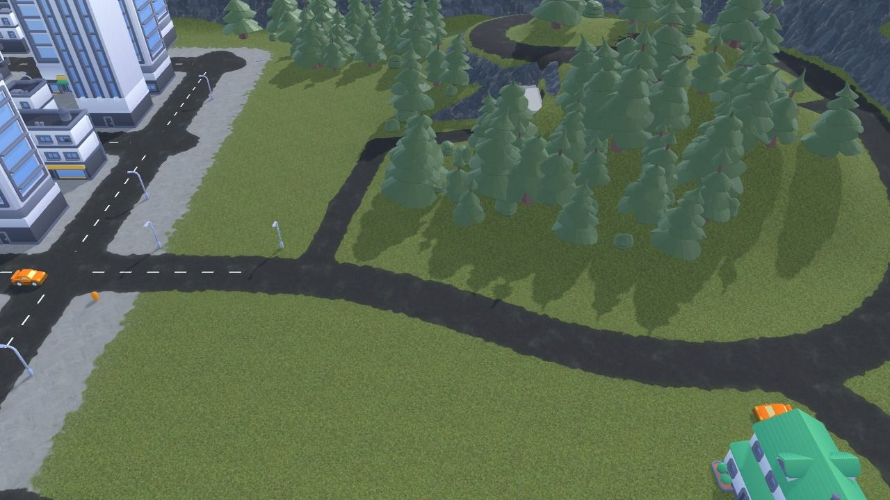
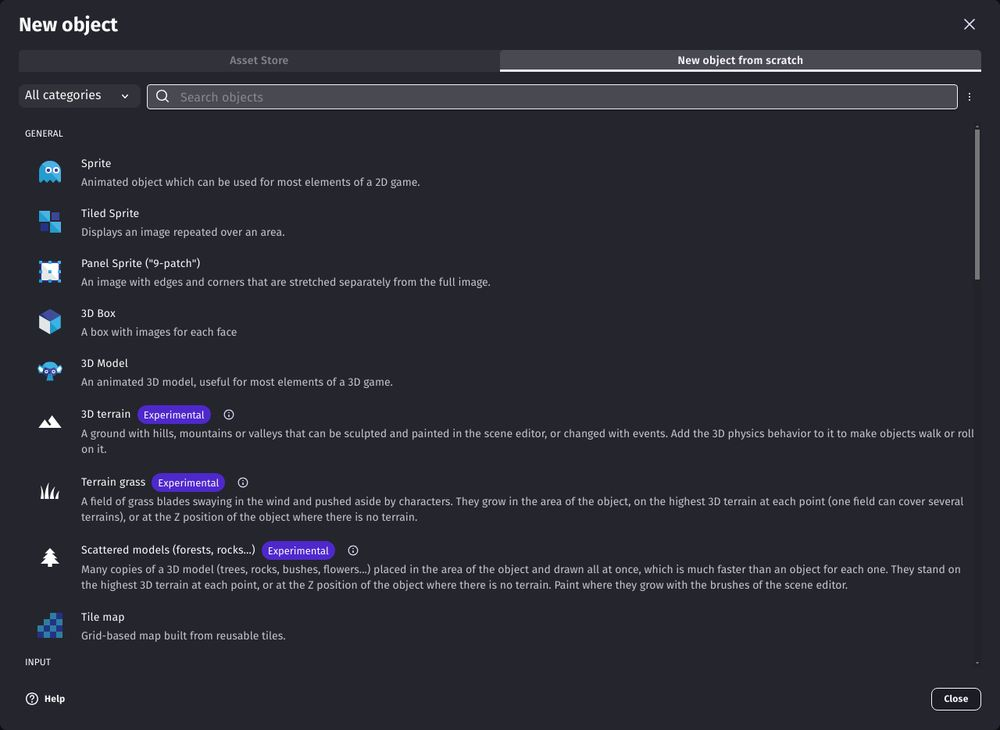
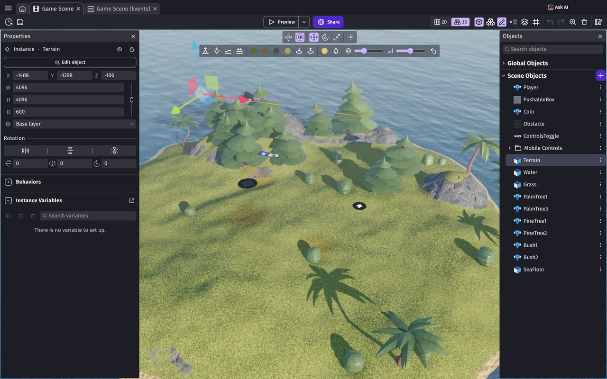
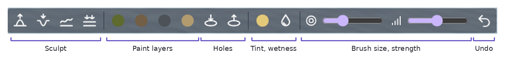
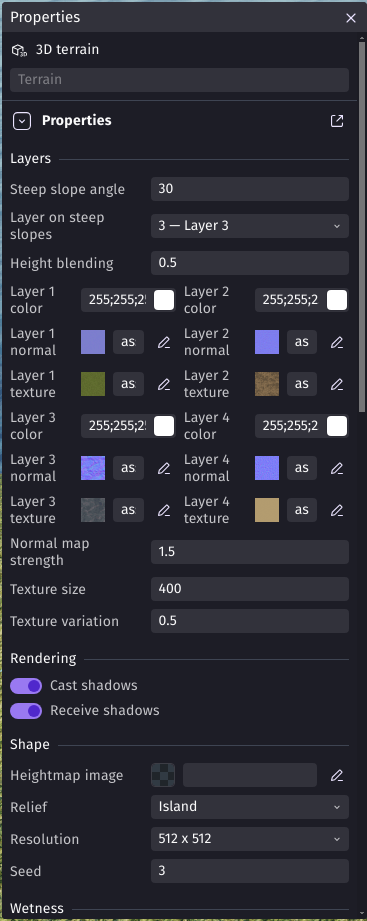

# 3D Terrain

The **3D terrain** object is the ground of open worlds, adventure games, racing games or any 3D game that needs more than a flat floor: hills, mountains, valleys, islands, roads and paths. You shape it directly in the scene editor with brushes, like in a painting software, and paint it with up to 4 layers of textures (grass, dirt, rock, sand...).

The terrain comes with two companion objects, which follow its shape automatically:

- **Terrain grass**: thousands of blades of grass swaying in the wind, growing where the ground is painted with grass. See [Grass](grass.md).
- **Scattered models**: forests, rocks, bushes or flowers made of hundreds or thousands of copies of a 3D model, drawn much faster than an object for each tree. See [Forests, rocks and bushes](scattered-models.md).

The terrain can also have holes for the entrances of [tunnels and caves](holes-and-tunnels.md), and be tinted or made wet (see [Sculpting and painting](sculpting-and-painting.md)).

!!! tip

    Open the **3D GTA with a map** and **3D island terrain** examples from the home page of GDevelop to see a terrain with roads, forests, a tunnel, a beach and water, and to try the tools of this page on them.

## Add a terrain to a scene

In the objects list, add a new object and choose **3D terrain** in the "New object from scratch" tab. The grass and the scattered models are listed next to it.

The terrain objects are in an extension of the community: if they are not listed, click the menu at the right of the search bar and choose to show experimental objects, or search for "terrain" in the extensions. Ready-to-use terrains (green hills, a tropical island, snowy mountains, desert dunes...) are also available in the asset store: search for "3D terrains".

Put an instance of the terrain in the scene: its **width** and **height** are the size of the ground, and its **depth** is the height of the highest mountains. The **Z** position of the instance is the lowest point of the ground.

!!! note

    A terrain is often much bigger than the screen. A size of 4096 x 4096 is a good start for an island or a level, and 8192 x 8192 or more for an open world. For bigger worlds, put several terrains side by side.

## Edit the terrain in the scene editor

Select the terrain in the scene editor (click on the ground) to show its tools at the top of the 3D view:

- **Sculpt**: raise, lower, smooth or flatten the ground.
- **Paint layers**: paint one of the 4 layers (shown with their color).
- **Holes**: make holes in the ground, or fill them again.
- **Tint and wetness**: change the color of the ground, or make it wet.
- **Brush size and strength**, and **Undo** for the last strokes.

Choose a tool, then drag on the terrain to use it. Click again on the tool to stop using it and select other objects. Everything is explained in [Sculpting and painting](sculpting-and-painting.md).

Your strokes are saved in the project when you release the mouse button. They are kept on top of the starting shape of the terrain (see below), so you can still change it afterwards.

## Start from a relief or a heightmap

Instead of sculpting everything by hand, start from a shape given in the properties of the object, in the **Shape** group:

- **Relief**: flat, hills, mountains or an island. Change the **Seed** to get another terrain with the same kind of relief.
- **Heightmap image**: a grayscale image where black is the lowest ground and white the highest (at the depth of the instance). Use it to import a terrain made in another software, or a real place.
- **Resolution**: the number of cells on each side of the terrain. A higher resolution allows smaller details (like a narrow path or a small ditch), but takes more memory and time to load. Use the lowest resolution that keeps the details you need.

The tools of the scene editor change the terrain on top of this shape.

## Layers and textures

{ align=right width=280 }

A terrain has 4 layers, usually grass, dirt, rock and sand. Each layer has a **color** and, optionally, a **texture** (tinted by the color) and a **normal map** to show the bumps of the texture under the lights. Textures from ambientCG (with their "Color" and "NormalGL" images) work great.

A few properties make the ground look more natural:

- **Layer on steep slopes** and **Steep slope angle**: the slopes steeper than this angle automatically show a layer (usually rock), whatever is painted there. Sculpt a hill and its sides become rocky.
- **Height blending**: where two layers meet, the stones or tufts of a texture cover the gaps of the other instead of fading into it.
- **Texture variation**: makes the repetition of textures less visible.
- **Texture size**: the size of one repetition of the textures in the scene.

A new terrain is fully painted with the first layer: paint the other layers where you need them (see [Painting the layers](sculpting-and-painting.md#painting-the-layers)).

## Lights and shadows

Like other 3D objects, the terrain is lit by the lights of the layer: a directional light (the sun) and a hemisphere or ambient light are recommended. The terrain can cast and receive shadows: hills cast shadows on valleys, and trees, characters and buildings cast shadows on the ground. See [3D lights](/gdevelop5/objects/3d-light).

## Collisions with characters, cars and objects

Add the **[3D physics behavior](/gdevelop5/behaviors/physics3d)** to the terrain: characters (with the 3D physics character behavior), cars and other objects will walk, drive or roll on it, exactly following its shape. The terrain is always static: it's never moved by the physics engine, but its collisions are updated when it's changed during the game.

For characters controlled by the computer, add the **floor/obstacle for pathfinding (navmesh based)** behavior to the terrain: characters with the [navmesh pathfinding behavior](/gdevelop5/behaviors/nav-mesh-pathfinding) will find their way on its hills and around its cliffs.

## Use the terrain in events

The terrain can be read and changed during the game with events. Some examples:

- Put objects on the ground: the **Put objects on the ground** action places objects (or a group of objects) at the height of the ground under them. It's useful for objects created during the game, like collectibles or enemies.
- Read the **ground Z position**, **slope** or **painted layer** at a position: to know if a character walks on sand or on a road (to play other footstep sounds, or slow down a car on grass), or to spawn objects only on flat ground.
- Raise, lower, flatten, smooth and paint the ground: craters after an explosion, footprints, a road built by the player, terraforming... Raising and painting also work along a line, for paths, rivers or the trail of a vehicle.
- Generate a new relief with a seed, or load a heightmap, for worlds made at random or loaded from levels.

All the actions, conditions and expressions are listed in the [reference of the 3D terrain extension](/gdevelop5/extensions/terrain3d).

## Learn more

- [Sculpting and painting](sculpting-and-painting.md): the brushes, painting layers, tint and wetness, and the "Edits" property.
- [Grass](grass.md): fields of grass swaying in the wind.
- [Forests, rocks and bushes](scattered-models.md): scattered models.
- [Holes and tunnels](holes-and-tunnels.md): tunnels, caves and wells.
- [Tips and best practices](tips.md): performance, mobile games, big worlds and common problems.
