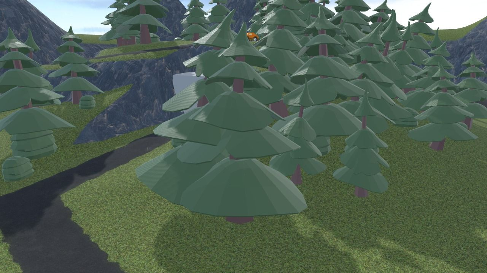
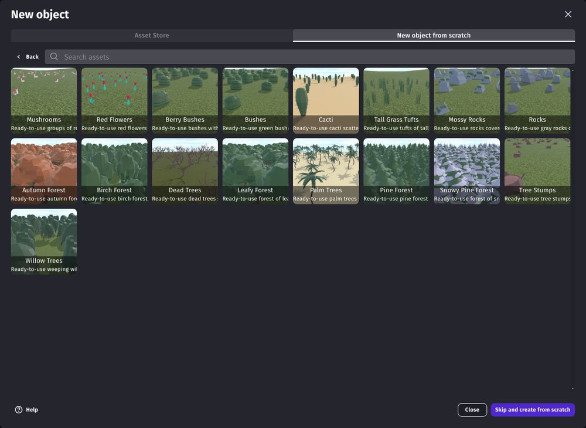
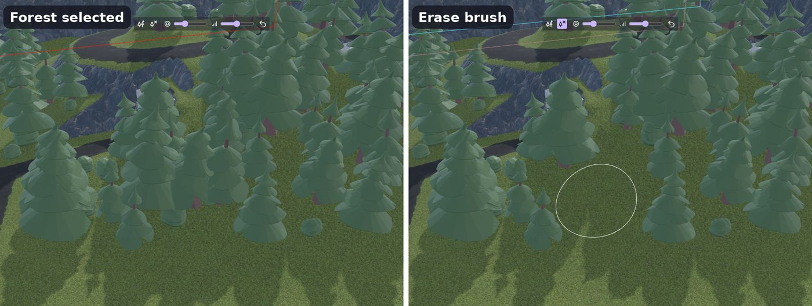

# Forests, rocks and bushes (scattered models)

A **scattered models** object places hundreds or thousands of copies of a 3D model on the ground: trees of a forest, rocks, bushes, flowers, mushrooms, tree stumps... All the copies are drawn at once, which is much faster than an object for each tree, including on phones. The copies follow the [3D terrain](index.md) when it's sculpted.

## Add a forest

The quickest way is to start from a ready-to-use forest: in the new object dialog, choose **Scattered models** in the "New object from scratch" tab. The assets of the "3D Scattered Models" pack are shown: forests of pines, leafy trees, birches, palm trees, rocks, bushes, flowers, cacti... Each one is already set up with a model, a size, a density and the slopes where it grows. Choose "Skip and create from scratch" to use your own 3D model (a .glb file).

Put an instance of the object over the terrain: copies grow in the **area of the instance** (its width and height), on the highest terrain at each point, or at the Z position of the instance where there is no terrain. To cover a whole terrain, give the instance the same position and size as the terrain.

Use one object for each kind of model: a pine forest, a leafy forest, bushes and rocks are four objects, which can cover the same area.

## Choose where copies grow

In the properties of the object:

- **Copies grow**: **everywhere** in the area, or only where they are **painted** with the brushes or the edits (see below). Painted is best for forests with clearings, groves along roads, or rocks at the foot of cliffs.
- **Grows on terrain layer**: copies only grow on this layer of the terrain, away from its borders. Paint roads and paths with another layer, and trees never stand on them.
- **Maximum slope**: no copies on steeper ground. Use a low value for trees, and a higher one for rocks.
- **Minimum ground Z** and **Maximum ground Z**: no copies under the water level (set the minimum to the Z of the water) or above the tree line on mountains (set the maximum).
- **Density**: the number of copies in a square of 100 x 100 pixels. Copies are placed at random in a grid, so they never pile up on each other.
- **Seed**: changes where the copies are, for another forest with the same density.

## Paint and erase copies in the scene editor

Click on a copy (like a tree) in the scene editor to select its object, and show its brushes above the 3D view:

- **Add copies** paints where copies grow (when "Copies grow" is "painted"). With "everywhere", it brings back copies that were erased.
- **Erase copies** removes copies: for clearings, the space around houses, or a path through a forest.
- The **size** and **strength** of the brush, and **Undo**.

!!! tip

    When the terrain is selected, clicks on the ground are used by the brushes of the terrain. Choose another tool, or click again on the tool to stop using it, then click on a tree to select the forest.

Like for the terrain, an **Edits** property (click "Show more" in the properties) lists the places where copies are added or erased, in a JSON format that can be changed by hand or by an AI. The brushes save their changes in the **Painted data** property: clear it to remove them.

## Make the copies look natural

- **3D model** and **Height of a copy**: copies keep the proportions of the model. Models made standing on the Y axis, like most models of the asset store, are stood up automatically.
- **Smallest** and **largest random scale**: each copy gets a random scale between them, for trees of different ages.
- **Random rotation**: turns each copy around the vertical axis, so that they don't all look the same.
- **Random tint**: each copy is tinted between white and this color, for slightly different shades of leaves (white for no tint).

## Collisions: trees that stop the player

Rocks and trees should usually stop characters and cars, while bushes, flowers and grass tufts should not:

1. Enable **Trunk collisions** in the properties of the object, and set the **Trunk diameter**: each copy gets a collision shape around its trunk (or around the rock), scaled with the copy.
1. Add the **[3D physics behavior](/gdevelop5/behaviors/physics3d)** to the object, with the "Static" type.

Characters and cars then bump into trees, while still walking under their branches. For characters controlled by the computer, add the **floor/obstacle for pathfinding (navmesh based)** behavior to the object too: they will walk around the trunks.

Without trunk collisions, these behaviors have no effect on the object: characters walk through the copies.

## Use copies in events

The copies are not objects: they can't have their own variables or behaviors, but the object has actions, conditions and expressions to use them:

- **Cut trees, break rocks, harvest bushes**: get the position of the nearest copy to the player (with the "X/Y position of the nearest copy" expressions), check the distance to it, then use the **Erase copies** action at this position, with a small radius. Create a falling tree (a 3D model object) at the same place for an animation.
- **Plant trees** with the **Add copies** action.
- Count the copies, for example to know how many trees are left in a forest.

All the actions, conditions and expressions are listed in the [reference of the 3D terrain extension](/gdevelop5/extensions/terrain3d).

!!! tip

    Use regular [3D model objects](/gdevelop5/objects/3d-model) for the few trees or rocks that need their own behaviors or animations, like a tree that falls or a rock hiding a treasure, and scattered models for all the others.

## Performance

- **Draw distance**: copies shrink and disappear at this distance from the camera. Use a short distance for small plants (flowers, grass tufts, mushrooms), and a longer one for trees, which are seen from far.
- **Cast shadows**: disable it for small plants and rocks. Shadows of trees look great, but cost more.
- A lower **density** is faster, and often looks better: a forest doesn't need to be dense everywhere. Paint dense groves and keep sparse trees elsewhere.
- Models with fewer triangles are faster: low poly models, like the ones of the asset store, are a good fit.

See also [Tips and best practices](tips.md).
