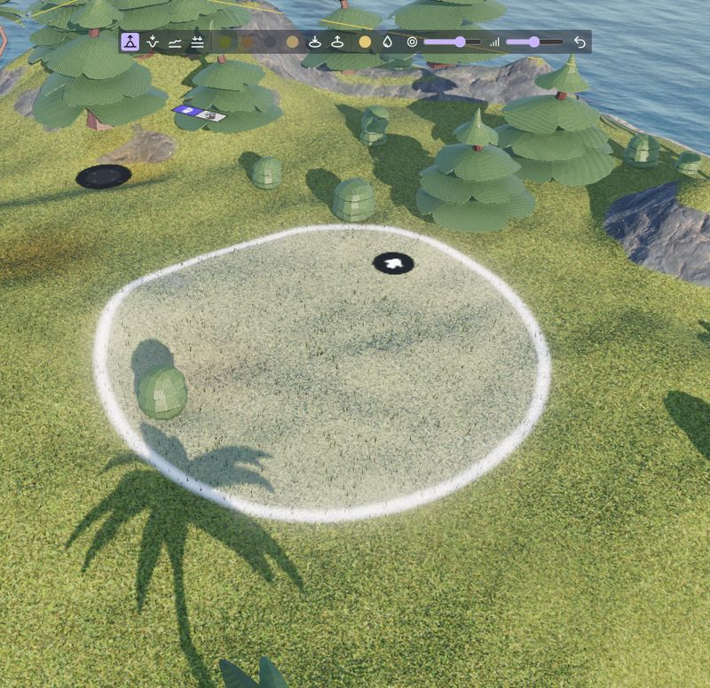
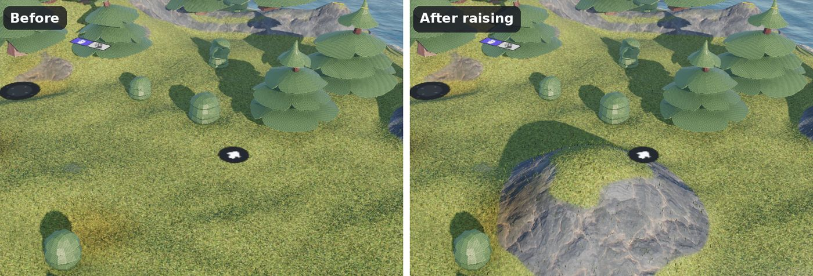
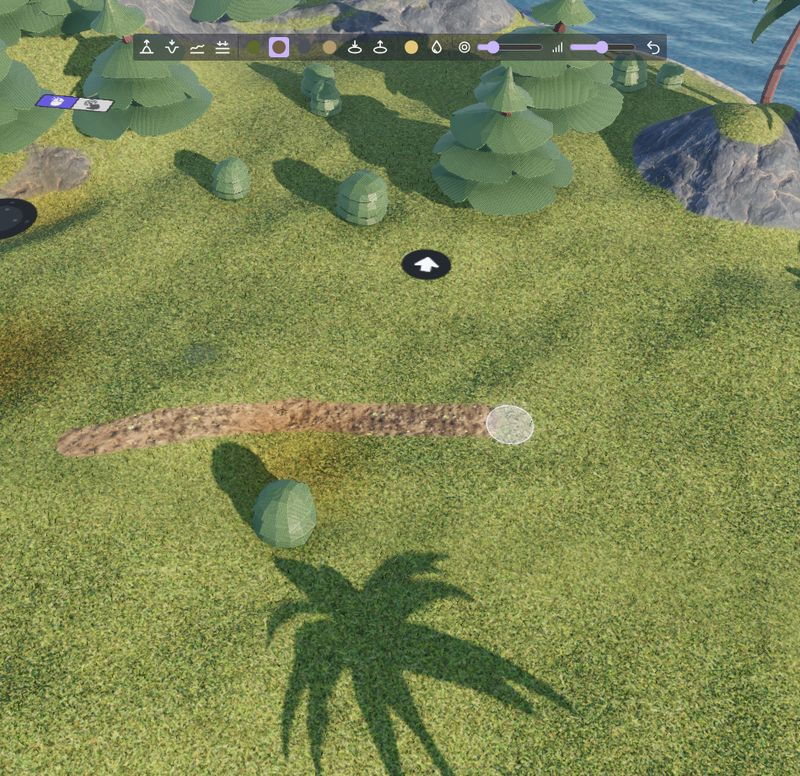
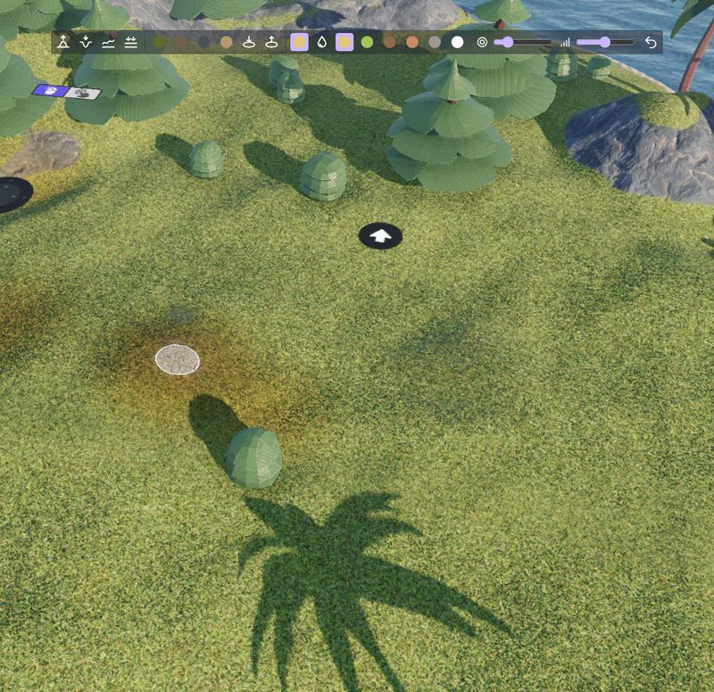
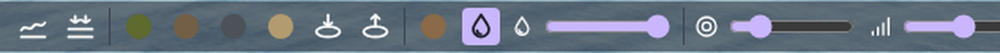
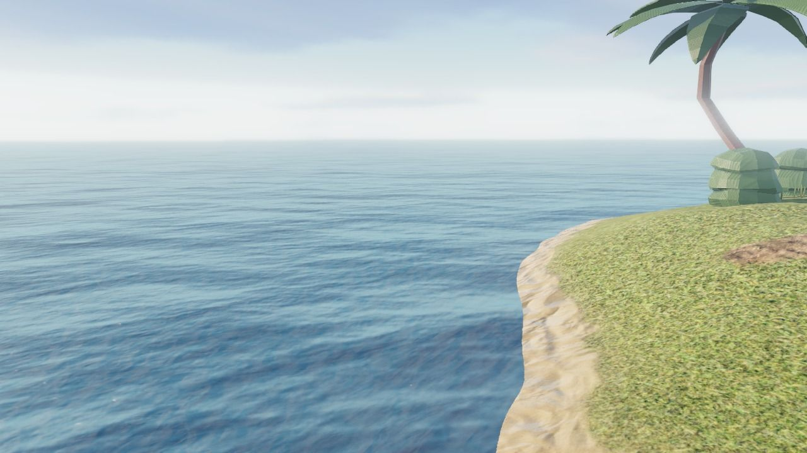
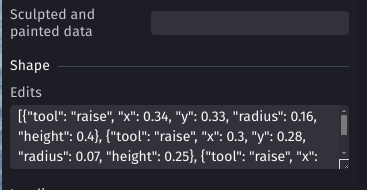

# Sculpting and painting a 3D terrain

Select a [3D terrain](index.md) in the scene editor to show its tools above the 3D view. Choose a tool, then drag on the terrain: a circle shows where the brush is. Click again on the tool to stop using it.



The **brush size** and **brush strength** sliders change all the brushes. Use a big brush with a low strength for the large shapes (hills, valleys), then a smaller brush for the details. **Undo** removes the last strokes made on the terrain.

## Sculpting

- **Raise** and **Lower**: build hills and mountains, or dig valleys, lakes and riverbeds. The longer you hold the mouse button, the higher or deeper the ground goes.
- **Smooth**: softens bumps and sharp edges. Use it after raising or lowering to get natural slopes.
- **Flatten**: brings the ground to the height where the drag starts. Use it for plateaus, the ground under buildings, and the bed of roads: start the drag on the road, then drag along it.



The sides of the hill above became rocky by themselves: the slopes steeper than the **Steep slope angle** show the **Layer on steep slopes**, whatever is painted there. Raise the angle to keep more grass on slopes, or lower it for a more rocky landscape.

!!! tip

    Objects placed on the terrain (trees, buildings, characters) don't move when you sculpt under them. Sculpt the terrain first, then place objects. The [grass](grass.md) and [scattered models](scattered-models.md) always follow the ground.

## Painting the layers

The 4 layer buttons (shown with the color of each layer) paint a layer: dirt for paths, sand for beaches, rock for cliffs, or any texture you've set in the properties of the terrain (see [Layers and textures](index.md#layers-and-textures)). The strength of the brush makes the layer cover the others more or less quickly, for soft or sharp borders.



Painting is also how you choose where the [grass](grass.md) and the [scattered models](scattered-models.md) grow: they only grow on the layer given in their properties. In the image above, the grass doesn't grow on the dirt path. Paint roads with their own layer and trees will never stand in the middle of them.

!!! tip

    Use a texture with a normal map for each layer: the light of the sun makes the stones, cracks and tufts of the textures stand out. The ambientCG website has free textures for grass, dirt, rock, sand, snow, asphalt or tiles, with their normal maps ("NormalGL").

## Tinting the ground

The **Tint** tool multiplies the color of the ground by a color, without changing the painted layers. Use it for variety: dry or yellow patches in a meadow, burnt ground, darker soil under trees, autumn colors, or a reddish sand. Painting with white removes the tint.



Choose the color of the brush in the toolbar after selecting the tool. The blades of the [terrain grass](grass.md) take the tint of the ground under them, so a dry patch also has dry grass.

## Wet ground

The **Wetness** tool makes the ground darker and shinier, like wet soil or sand. A slider next to it sets the wetness of the brush: all the way to the right for soaked ground, all the way to the left to dry the ground again.



Use it for puddles on a path, a muddy riverbank, or the ground around a fountain. For the sand of a beach, there is no need to paint: in the **Wetness** group of the properties, enable **Wet shore** and set **Wet below Z** to the height of the water. The ground is wet under this height, and dries progressively over the height given in **Wet shore fade**.



!!! tip

    Set "Wet below Z" a bit above the Z position of your water object: the sand just above the water is wet too, as if the waves had just retreated.

## The "Edits" property: a terrain described in text

{ align=right width=300 }

In the **Shape** group of the properties (click "Show more"), the **Edits** property describes changes of the terrain as a list of strokes written in JSON: raise, flatten, smooth, paint, tint, wetness, hole and fill. They are applied in order on top of the relief or the heightmap.

Edits are useful because they can be read and changed: copy a road from a terrain to another, move a hill by changing its position, or ask the AI of GDevelop to shape the terrain ("add a lake in the north", "make a road from the town to the hill"). Strokes can follow a line (with `toX` and `toY`), and a flattened road can go up or down a slope (with `toZ`).

Positions and sizes are fractions of the size of the terrain (0 is the left or top border, 1 the right or bottom border), and heights are fractions of its depth, so edits stay at the same place if the terrain is resized. For example, this flattens a road going up from the left of the terrain to its center, then paints it with the second layer:

```json
[
  {"tool": "flatten", "x": 0.1, "y": 0.5, "toX": 0.5, "toY": 0.5, "radius": 0.02, "z": 0.05, "toZ": 0.2},
  {"tool": "paint", "x": 0.1, "y": 0.5, "toX": 0.5, "toY": 0.5, "radius": 0.015, "layer": 2}
]
```

The description of the property, shown in the editor, lists all the tools and their parameters.

<div style="clear: both;"></div>

The brushes of the scene editor don't write in the edits: they save their changes in the **Sculpted and painted data** property, in a compact format that is not meant to be read. Clear this property to remove all the changes made with the brushes and go back to the relief, the heightmap and the edits.

## Changing the terrain during the game

The same tools are available as actions in the events: raise, lower, flatten, smooth, paint, tint, change the wetness, make or fill holes. They can be used for craters after an explosion, a road that the player builds, footprints in the snow, a puddle growing when it rains, or wet ground drying in the sun. Collisions are updated with the ground.

These changes only exist during the game: they are not saved in the project. All the actions, conditions and expressions are listed in the [reference of the 3D terrain extension](/gdevelop5/extensions/terrain3d).
